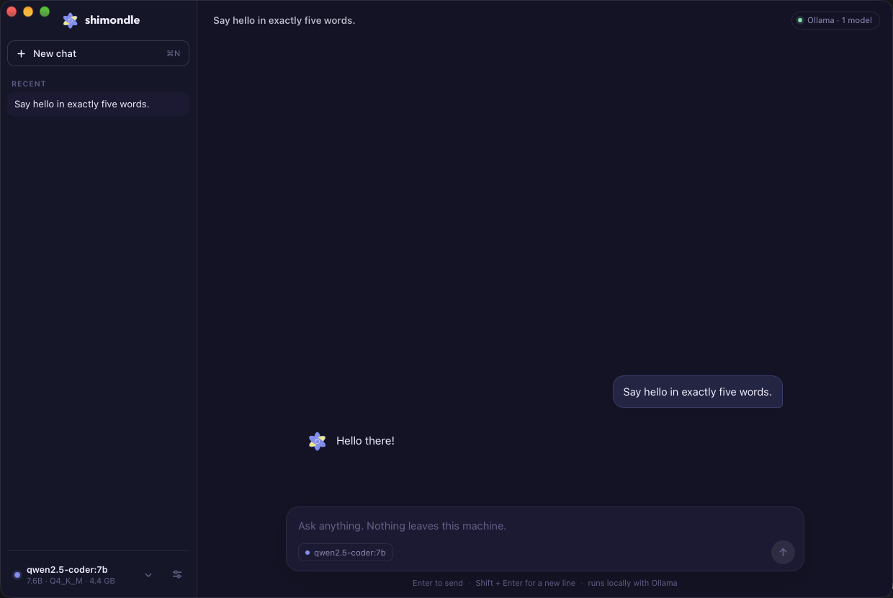

# Shimondle

A quiet desktop front end for [Ollama](https://ollama.com). Local models, no accounts, no cloud, no telemetry.



## What it does

- **Talks to your local Ollama** at `http://127.0.0.1:11434` (configurable), streaming tokens as they arrive.
- **Model picker** listing every model you have pulled, with size and quantisation.
- **Real chat history** with multiple conversations, auto-titles, delete, regenerate and stop.
- **Markdown rendering** with syntax-labelled code blocks and per-block copy.
- **Temperature, context window and system prompt** per app, not per chat.
- **Light and dark themes**, both drawn from the Shimondle palette (`#8E95F2` periwinkle, `#F2EB8E` butter).

## Requirements

- macOS 12 or newer (Apple silicon build)
- Ollama running locally with at least one model: `ollama pull qwen2.5-coder:7b`

## Run it

```bash
npm install
npm run tauri dev      # hot reload
npm run tauri build    # -> src-tauri/target/release/bundle/
```

The built app lands at `src-tauri/target/release/bundle/macos/Shimondle.app`
and a disk image at `src-tauri/target/release/bundle/dmg/`.

The build is ad-hoc signed, not notarised. If you copy it to another Mac,
right-click → Open, or `xattr -dr com.apple.quarantine Shimondle.app`.

## How it works

```
src/                 front end (TypeScript, no framework)
  main.ts            app state, rendering, streaming, settings
  ollama.ts          Tauri bridge + demo fallback for browser preview
  markdown.ts        small safe markdown renderer
  store.ts           conversations and settings in localStorage
src-tauri/src/lib.rs Rust: /api/tags, /api/chat streaming, cancellation
```

All HTTP happens in Rust (`reqwest`), so the webview never needs network
access and there is no CORS surface. Chat responses come back over a Tauri
`Channel` as NDJSON deltas; `cancel_chat` flips a flag that the stream loop
checks between chunks.

`npm run shot` renders the UI in headless Chrome with the Ollama bridge
mocked, which is how the screenshots in `docs/` were made.

## Design

| token | dark | light |
| --- | --- | --- |
| canvas | `#14122A` | `#FBFAF6` |
| sidebar | `#171530` | `#F3F1EA` |
| panel | `#1D1A3A` | `#FFFFFF` |
| accent | `#8E95F2` | `#8E95F2` |
| accent 2 | `#F2EB8E` | `#F2EB8E` |

Wordmark set in Avenir Next 700. The mark is the supplied artwork, cut out to
transparency (`assets/mark-dark.png`, `assets/mark-light.png`) and used for the
app icon, the sidebar brand, message avatars and the empty state.
